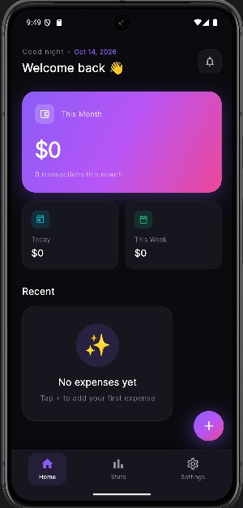
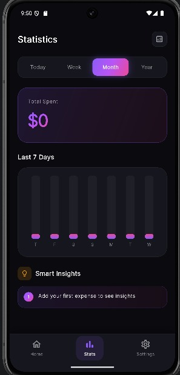
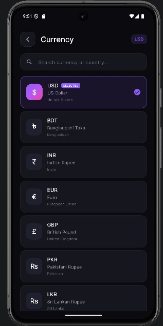

# 💗 Pulse — Life Energy Tracker

A beautiful, minimal app that tracks not just **where your money goes**, but **what it's doing to your life**.

<p align="center">
  
  
  
  
</p>

---

## 🌟 What Makes Pulse Different

Most expense trackers only answer: **"Where did my money go?"**

Pulse answers: **"What is my money doing to my life?"**

Every expense is tracked with **3 layers**:
- 💰 **Money** — classic tracking
- 😊 **Mood** — how you felt when spending
- 🧠 **Life Impact** — which area of life it served

---

## ✨ Features

### 💵 Smart Tracking
- Add expenses with amount, category, mood, note, date
- 20+ categories across 6 life areas
- Beautiful category grid with emojis
- Quick date picker

### 📊 Visual Analytics
- **Pie Chart** — category breakdown
- **Bar Chart** — daily spending trends (7 days)
- **Mood Breakdown** — emotional spending pattern
- **Life Energy Map** — where your money flows
- **Time Filter** — Today / Week / Month / Year

### 🧠 Smart Insights (Auto-Generated)
- Detects emotional spending patterns
- Highlights biggest expenses
- Compares Comfort vs Growth spending
- Stress-spending warnings
- Average daily spending

### 🎨 Premium UI
- Dark theme with glassmorphism
- Purple → Pink gradients
- Smooth 60fps animations
- Haptic feedback
- Minimal, modern design

### 🌍 50+ Currencies
- USD, EUR, GBP, BDT, INR, JPY, and more
- Instant search
- Change anytime

### 🔒 100% Private
- All data stored locally (Hive)
- No internet required
- No account needed
- No ads, no tracking

---

## 📱 Screenshots

| Home Dashboard | Stats & Charts |
|:--------------:|:--------------:|
|  |  |

| Smart Insights | Add Expense |
|:--------------:|:-----------:|
|  |  |

---

## 🛠️ Tech Stack

- **Flutter** 3.47+
- **Dart** 3.13+
- [hive](https://pub.dev/packages/hive) — Fast local database
- [provider](https://pub.dev/packages/provider) — State management
- [fl_chart](https://pub.dev/packages/fl_chart) — Beautiful charts
- [flutter_animate](https://pub.dev/packages/flutter_animate) — Smooth animations
- [google_fonts](https://pub.dev/packages/google_fonts) — Typography
- [intl](https://pub.dev/packages/intl) — Date & number formatting
- [uuid](https://pub.dev/packages/uuid) — Unique IDs

---

## 📥 Download APK

[](https://github.com/developeroption14/Pulse/releases/latest)

Or build from source:

```bash
flutter build apk --release --split-per-abi
```

---

## 🚀 Installation

```bash
git clone https://github.com/developeroption14/Pulse.git
cd pulse
flutter pub get
flutter run
```

---

## 📦 Build APK

```bash
flutter build apk --release --split-per-abi
```

The APK will be generated at:
- `build/app/outputs/flutter-apk/app-arm64-v8a-release.apk` (Modern phones)
- `build/app/outputs/flutter-apk/app-armeabi-v7a-release.apk` (Older phones)

---

## 📂 Project Structure

```
lib/
├── main.dart                        # Entry point
├── models/
│   ├── expense.dart                 # Expense model (Hive)
│   └── mood.dart                    # Mood enum + colors
├── services/
│   ├── hive_service.dart            # Database initialization
│   └── expense_service.dart         # CRUD operations
├── providers/
│   └── expense_provider.dart        # State management + Insights
├── theme/
│   └── app_theme.dart               # Design system
├── utils/
│   ├── categories.dart              # Categories + Life Areas
│   ├── currencies.dart              # 50+ currencies
│   └── formatters.dart              # Date/currency formatting
├── widgets/
│   ├── glass_card.dart              # Frosted glass component
│   ├── gradient_button.dart         # 3D gradient button
│   ├── insights_widget.dart         # Smart insights
│   └── life_energy_map.dart         # Life area visualization
└── screens/
    ├── splash_screen.dart           # Animated splash
    ├── main_screen.dart             # Bottom nav wrapper
    ├── home_screen.dart             # Dashboard
    ├── add_expense_screen.dart      # Add form
    ├── stats_screen.dart            # Analytics
    ├── all_expenses_screen.dart     # Full list
    ├── currency_picker_screen.dart  # Currency selector
    └── settings_screen.dart         # Settings
```

---

## 🎨 How to Use

1. **Add expense:** Tap the **+** button
2. **Choose category:** Tap any emoji (20+ options)
3. **Select mood:** How did you feel?
4. **Save:** Data saves locally automatically
5. **View stats:** Tap **Stats** tab
6. **Track patterns:** See where your money flows
7. **Change currency:** Settings → Currency

---

## 🌈 Life Areas

Every expense is categorized into 6 life areas:

- ❤️ **Health** — Food, gym, medicine
- 🧠 **Growth** — Books, courses, learning
- 🤝 **Relationships** — Family, gifts, dining
- 🛋️ **Comfort** — Rent, bills, subscriptions
- 📱 **Status** — Shopping, fashion, gadgets
- 🎉 **Fun** — Entertainment, games, travel

---

## 👨‍💻 Author

**Shrabon** — [@developeroption14](https://github.com/developeroption14)

---

## 📄 License

This project is open source and available under the **MIT License**.

---

⭐ If you like this project, give it a star!
